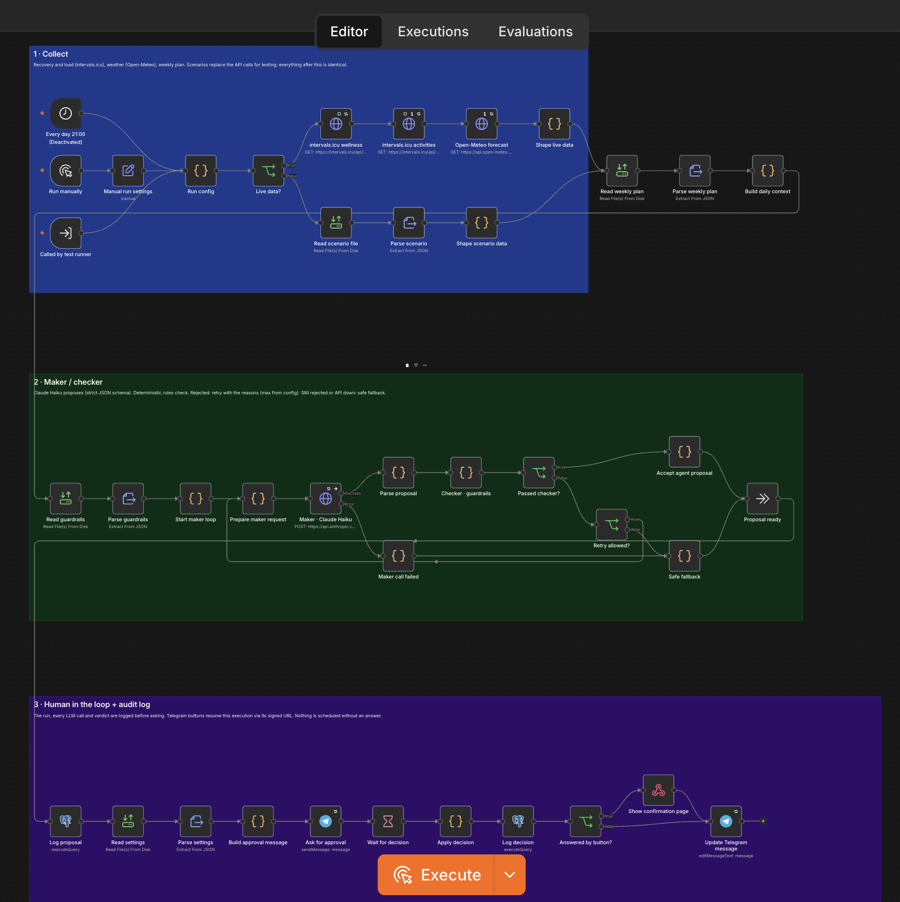
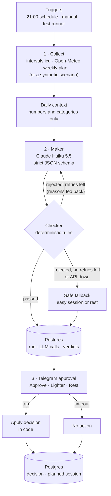
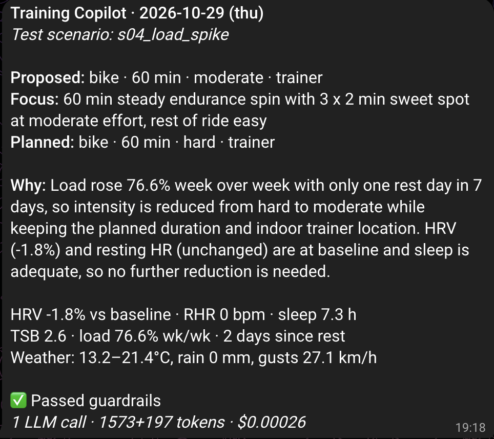

# Training Copilot

An n8n workflow that plans my next-day triathlon session (IRONMAN 70.3 Cascais 2027) from recovery, training load, weather and my weekly plan. An LLM agent proposes the session, deterministic guardrails check it, and nothing is scheduled until I approve it in Telegram. Every run is logged in Postgres with its inputs, verdicts, human decision, latency, tokens and cost.



## What it demonstrates

| Capability | Where |
|---|---|
| Low-code orchestration across systems (n8n, REST APIs, webhooks, light JS) | [`workflows/training-copilot.json`](workflows/training-copilot.json): intervals.icu, Open-Meteo, Anthropic, Telegram, Postgres |
| Maker/checker agent pattern with retries and a safe fallback | Section 2 of the workflow, [`maker.js`](workflows/code/maker.js), [`checker.js`](workflows/code/checker.js) |
| Deterministic guardrails, owned and versioned outside the code | [`config/guardrails.json`](config/guardrails.json) |
| Human in the loop before any action | Telegram approval, [`approval.js`](workflows/code/approval.js) |
| Observability, audit trail and agent-run evaluation | [`sql/01_schema.sql`](sql/01_schema.sql), [`sql/kpis.sql`](sql/kpis.sql) |
| AI cost governance: cost per run derived from versioned prices | `model_pricing` table and the `v_llm_call_cost` view |
| Sensitive-data handling and least-privilege access | [Data protection and access control](#data-protection-and-access-control) |

## Architecture



**1 · Collect.** Pulls 7 days of wellness data (HRV, resting HR, sleep, fitness and fatigue) and 14 days of activities from intervals.icu (synced from Garmin), plus tomorrow's Lisbon forecast from Open-Meteo and the planned session from [`data/plan/weekly_plan.json`](data/plan/weekly_plan.json). For testing, a scenario file replaces the three API responses; everything downstream is identical. One tested function, [`build_context.js`](workflows/code/build_context.js), turns raw data into the *daily context*, the only thing the model sees: values relative to my own baseline, load ramp, weather and data-quality flags.

**2 · Maker/checker.** Claude Haiku 5.5 proposes one session as strict JSON (structured outputs, effort `low`). The prompt states the policy in plain words but no thresholds; the checker enforces the numbers. On rejection the maker is asked again with the exact reasons, up to `max_maker_retries`. If it still fails, or the API is down after 3 HTTP retries, a rule-based fallback proposes an easy session or rest. The fallback goes through the checker too, so it's provably within the rules.

**3 · Human in the loop.** The run is logged first, then Telegram receives the proposal, rationale, key signals and cost, with three buttons. Each button is a link to this execution's signed resume URL, so the waiting workflow continues with my answer. The decision is applied in code (Lighter = one intensity level down), logged as an insert-only row, and the Telegram message is edited to show the outcome. No answer within the timeout means nothing is scheduled.

Example proposal from the logs (scenario `s05_rain_long_ride`):

```json
{
  "sport": "bike", "duration_min": 150, "intensity": "easy", "location": "trainer",
  "focus": "Long steady indoor ride, 150 min easy in zone 2, cadence 85-95 rpm, fuel every 20 min",
  "rationale": "Heavy rain (90% probability, 14 mm) and gusts up to 66 km/h make an outdoor ride unsafe, so the long ride moves to the trainer at the same duration and intensity. Recovery is at or better than baseline (HRV +10.8%, resting HR flat, 8.1 h sleep), and load is slightly down, so no reduction is needed.",
  "changed_from_plan": true
}
```



## Guardrails

Thresholds are mine to set as the athlete, not the agent's or the developer's. They live in a versioned config, and every verdict records the rules version it was checked against. A rule with no value is reported as `not_configured` on every run; it never passes silently.

| Rule | Condition | Constraint |
|---|---|---|
| R1 HRV drop | HRV more than 12% below its 7-day baseline | no hard session |
| R2 Short sleep | under 6 h | no hard session |
| R3 Elevated resting HR | more than 5 bpm above baseline | easy or rest |
| R4 Fatigue | form (TSB) below −25 | easy or rest |
| R5 Load ramp | 7-day load more than 15% above the previous 7 days | no hard session |
| R6 Rest overdue | 6 or more days without rest | easy or rest |
| R7 Duration cap | more than 1.25 × planned duration | rejected |
| R8 Weather | rain above 2 mm or gusts above 40 km/h | no outdoor ride |
| R9 Missing data | HRV, resting HR or sleep missing today | easy only |
| R10 Planned rest | rest day planned | stays rest |

There are also structural checks: valid JSON, allowed vocabulary, sport/location consistency, and rest-day shape.

## Results

14 completed runs on 2026-10-19: 12 synthetic scenarios and 2 live runs: one on real weather before my Garmin history had synced, and one on my own Garmin data (recovery, load and activities). Every decision was made by me in Telegram. Real health values stay in the local database; only these aggregates are published. Loop-mechanics tests against a test-only rule set are excluded. Reproduce with `./scripts/kpis.sh`.

| KPI | Value |
|---|---|
| Acceptance rate (approved as proposed) | 92.9% |
| Human correction rate (Lighter or Rest) | 7.1% (the one correction was a deliberate test of the Lighter path) |
| Checker rejection rate (per LLM proposal) | 6.7% (1 of 15; rule R9) |
| Runs needing a retry | 7.1%, all corrected on the first retry |
| Fallback rate | 0% |
| **Average cost per run** | **$0.00033** (≈ 1,713 input + 311 output tokens) |
| Agent latency (collect → proposal) | 3.0 s average, 3.8 s p90 |
| Median human response time | 4 min 33 s |

What the numbers say:
- **The checker is a backstop, not the main control.** The maker already follows the policy in most cases. The one rejection was a proposal that ignored missing recovery data, fixed on the retry using the checker's stated reason.
- **The fallback hasn't been needed in normal runs.** Its path is proven by a forced-failure test: a wrong API path gave HTTP 404, 3 retries, then the fallback, an easy session that passed the checker.
- **Cost is negligible at this scale:** about $0.12 a year for one run a day. The design point is that cost is measured per run and per call, from versioned prices, so it stays visible and auditable as volume grows.

## Data protection and access control

- **Minimisation:** the model receives numbers and categories only: no name, activity titles, GPS, device IDs, or timestamps beyond the date.
- **No real health data in this repo:** all committed data is synthetic ([`scripts/make_scenarios.py`](scripts/make_scenarios.py)). Real data is pulled at run time and stays in the local database.
- **Secrets:** only in n8n's encrypted credential store and a git-ignored `.env`. [`scripts/import_credentials.py`](scripts/import_credentials.py) streams them into n8n without writing them to disk. The workflow JSON references credentials by ID only. intervals.icu uses `athlete/0` (the key's owner), so no athlete ID is stored either.
- **Least privilege in Postgres:**
  - n8n writes with `copilot_writer`. It can't delete anything or change prices, and it can't edit a human decision once written.
  - KPIs run as `copilot_reader`, which is select-only and can't even create temp tables.
  - n8n's own database is closed to both roles.
- **Network:** every port is bound to `127.0.0.1`. The test-runner webhook requires a token. File nodes can read only `/data` and `/config`, and Code nodes can't read environment variables.
- **Retention:** n8n execution data (which contains health data) is pruned after 7 days.

## How to run

Requirements: Docker with Compose (Docker Desktop, or Colima on macOS), Python 3. Accounts: intervals.icu (free, synced with Garmin Connect), an Anthropic API key, a Telegram bot from @BotFather.

```bash
cp .env.example .env              # fill in keys; generate passwords with: openssl rand -hex 24
docker compose up -d              # n8n on http://localhost:5678, Postgres on 127.0.0.1:5433
# open n8n once and create the owner account, then:
python3 scripts/import_credentials.py
python3 scripts/build_workflows.py && ./scripts/n8n_import.sh
```

Create `data/private/settings.json` (git-ignored) with your Telegram chat ID: `{"telegram_chat_id": 123, "approval_timeout_min": 180}`. Send your bot a message first; `https://api.telegram.org/bot<token>/getUpdates` shows the ID.

```bash
./scripts/run_batch.sh all                          # all scenarios + one live run; answer in Telegram
./scripts/run_batch.sh s05_rain_long_ride           # one scenario
./scripts/kpis.sh                                   # KPI report (read-only role)
docker run --rm -v "$PWD":/work:ro -w /work --entrypoint node docker.n8n.io/n8nio/n8n:2.44.4 --test tests/   # 25 unit tests
```

Approve from Telegram on the machine running n8n (the buttons open `127.0.0.1`). The nightly 21:00 trigger ships disabled.

## Repository layout

```
workflows/            n8n workflow JSON (no secrets) + code/ with the Code-node logic
config/               guardrails.json (athlete-owned thresholds), guardrails.test.json (test-only)
sql/                  schema, migrations, KPI queries
data/plan/            weekly plan; data/sample/scenarios/ synthetic test data
scripts/              setup, build/import, batch runs, KPI report
tests/                unit tests for context builder, checker, maker parser, approval
```

## Limitations and next steps

- Most runs so far use synthetic scenarios; real-data runs start with one. Fitness and fatigue (CTL/ATL) are understated until my full activity history is in intervals.icu.
- Approval works from the machine running n8n only. Approving from a phone would need a tunnel, which also exposes n8n publicly, so it's a deliberate trade-off.
- n8n doesn't report how many HTTP retries it made, so `http_retries` is stored as unknown (NULL) rather than a misleading 0.
- Planned next: an error workflow with Telegram alerts, a KPI dashboard and evaluation set, pushing approved sessions to the intervals.icu calendar, and a section on running this for an HR Ops team at scale.

---

Built by Bruno Diogo, AI operations & automation, Lisbon.
